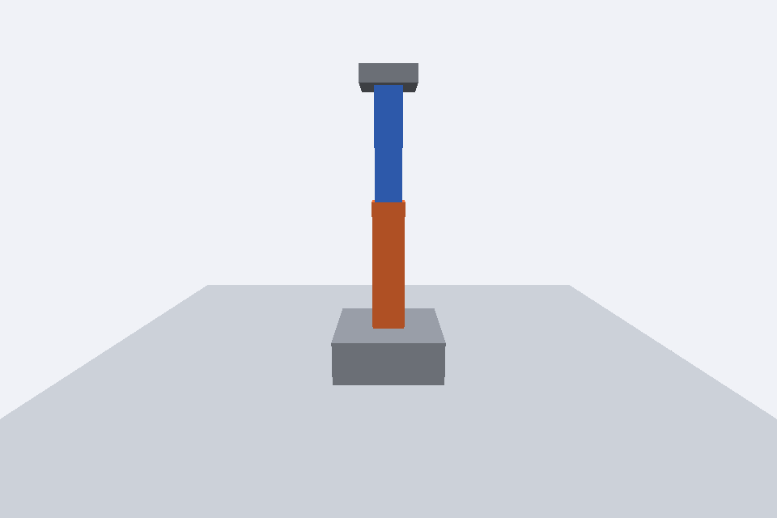

# Atividade 2 – Braço Robótico

**Disciplina:** Computação Gráfica
**Atividade:** Braço Robótico (Grafo de Cena)
**Integrantes:**
- Angelo Ricardo de Souza Teixeira
- Hamilton Ferreira de Souza 

## Descrição
O braço foi montado como uma hierarquia de objetos:

```
base (caixa cinza, altura 0.4)
└── ombro (Object3D, no topo da base: y = 0.2)
    ├── braço (caixa laranja 0.3 x 1.2 x 0.3, y = 0.6 -> ponta de baixo no ombro)
    └── cotovelo (Object3D, na ponta de cima do braço: y = 1.2)
        ├── antebraço (caixa azul 0.25 x 1.0 x 0.25, y = 0.5)
        └── garra (caixa cinza 0.5 x 0.15 x 0.5, na ponta do antebraço)
```

Controles (velocidade de 1.5 rad/s, multiplicada por `deltaTime`):
- **A / D:** giram a base, e com ela o braço inteiro, em torno do eixo Y.
- **W / S:** giram o ombro em torno do eixo Z.
- **I / K:** giram o cotovelo em torno do eixo Z.



## Resposta da questão
**Por que foi necessário utilizar pivôs em vez de simplesmente girar diretamente as caixas que representam o braço e o antebraço?**

Uma rotação sempre acontece em torno da origem local do objeto. A geometria de cada caixa é centralizada no seu meio, então girar a caixa diretamente faria o braço rodar em torno do próprio centro, e não da articulação.

O pivô é um `Object3D` posicionado exatamente na articulação (ombro ou cotovelo). A caixa é deslocada como filha do pivô, de modo que sua extremidade inferior fique encostada nele. Ao girar o pivô, a caixa gira em torno da junta, como uma articulação real. Além disso, no grafo de cena os filhos herdam as transformações dos pais. Assim, mover o ombro leva junto o cotovelo, o antebraço e a garra, e girar a base move o braço inteiro.
