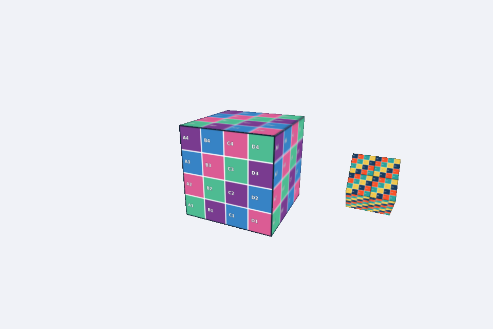

# Atividade 3 – Cubo com Satélite Texturizado

**Disciplina:** Computação Gráfica
**Atividade:** Cubo com Satélite Texturizado (Texturas)
**Integrantes:**
- Angelo Ricardo de Souza Teixeira 
- Hamilton Ferreira de Souza 

## Descrição
- **Cubo principal:** usa a textura `mosaico.png` e gira em torno do eixo Y.
- **Satélite:** segundo cubo com `grade_uv.png` e `repeatUV = [2,2]`, adicionado como **filho** do cubo principal (`self.mesh.add`). Por isso ele acompanha a rotação do cubo.
- **Posição e escala:** o satélite é primeiro posicionado a 1.3 no eixo X e só depois escalado para 0.4. Nessa ordem, a escala não reduz a distância ao centro.
- **Rotação própria:** o satélite gira em torno do próprio eixo X a 2 rad/s.
- **Teclado:** ↑ e ↓ aumentam e diminuem a velocidade de rotação do cubo principal (proporcional a `deltaTime`).

## Resposta da questão
**Qual é o papel das coordenadas UV em uma textura e qual é o efeito da configuração `repeatUV = [2,2]`?**

As coordenadas UV são coordenadas 2D (u, v), normalmente entre 0 e 1, associadas a cada vértice da malha. Elas indicam qual ponto da imagem de textura corresponde a cada ponto da superfície do objeto. Entre os vértices, os valores UV são interpolados, e a cor de cada pixel é buscada na imagem nessa posição.

`repeatUV = [2,2]` multiplica as coordenadas UV por 2, fazendo-as ir de 0 a 2. Com o modo de repetição da textura, a imagem aparece 2 vezes na horizontal e 2 vezes na vertical em cada face, ou seja, 4 cópias menores. Por isso a grade do satélite fica visivelmente mais densa.
